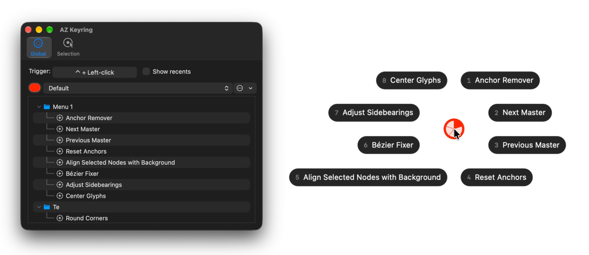
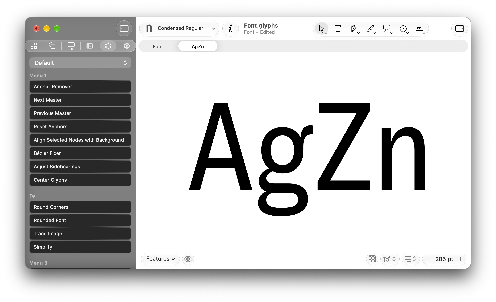

  

<h1 align="center">AZ Keyring</h1>

  <strong>Access your favorite scripts and commands from a radial menu</strong>

  <a href="#licence-and-trial"><picture>
    <source media="(prefers-color-scheme: dark)" srcset="https://img.shields.io/badge/30--day_free_trial-6690e3">
    
  </picture></a>
  &nbsp;
  
  &nbsp;
  <a href="https://azerty-typefaces.com"><picture>
    <source media="(prefers-color-scheme: dark)" srcset="https://img.shields.io/badge/More_AZ_plugins-242424">
    
  </picture></a>

---

  

*This is a plugin for the [Glyphs](https://glyphsapp.com/).*

Hold a trigger, and a ring of up to eight actions opens around the cursor. Flick toward one, let go, and it runs — a script from your Scripts folder, or any command from the Glyphs menus. One chord you can actually remember now reaches eight things you use every day.

## Getting started

1. Open *Window ▸ Plugin Manager*, find **AZ Keyring**, click *Install*.
2. Restart Glyphs.
3. Open *Window ▸ AZ Toolkit ▸ Keyring*. Glyphs Settings opens on the Keyring tab of **AZ Toolkit**, on its **Global** pane.
4. Click the **Trigger** button and press the chord you want, e.g. <kbd>⌃</kbd> <kbd>⌥</kbd> <kbd>R</kbd>, or hold a modifier and click a mouse button (<kbd>⌥</kbd> + right-click, <kbd>⌥</kbd> + middle-click). A modifier is required, so the trigger can never swallow a plain keystroke or click.
5. Add actions to the ring with **+**. Each one is a script from your Scripts folder or a Glyphs menu command, and can carry an icon.
6. Open a glyph in an Edit view, hold the trigger, flick, release.

## Using the ring

  

| While the ring is open | Does |
| --- | --- |
| Move the mouse toward a pill, release the trigger | Runs that action |
| <kbd>1</kbd> – <kbd>8</kbd> (top row or keypad) | Runs the pill with that number, immediately |
| <kbd>Tab</kbd> | Next ring of the current profile |
| Your Modifier | Peeks at the next profile; the active profile is unchanged once you let go |
| <kbd>Esc</kbd>, or release over the centre | Cancels |

A mouse trigger behaves the same way: the button holds the ring open and releasing it fires. Re-pressing the modifier while the button is down cycles profiles.

The ring only reacts while the cursor is over the glyph canvas of the front window. In the Font view, Font Info, text fields and other apps, the trigger does whatever it normally does.

## The selection ring

The **Selection** pane holds a second trigger and one ring per kind of selection: **Component**, **Path**, **Segment**, **Node** and **Anchor**. When you press the trigger, Keyring looks at your current layer selection and picks the according contextual ring. With nothing selected, the selection trigger opens your Global rings.

## Profiles and Recents

A **profile** is a complete set of rings, add more in the Global pane and switch between them there, from the sidebar's popup, or by peeking with <kbd>`</kbd> while a ring is open. The trigger is shared by every profile, so switching never changes how you open the ring.

**Recents** is a ring Keyring writes for you, prepended as the first ring of the profile: a blend of what you fired most recently and what you fire most often, so the action you are about to need tends to be one flick away. One checkbox turns it off for profiles that should stay exactly as you built them.

## Sidebar View (Glyphs 4)

  

If you aren't a big fan on the ring menu, for Glyphs 4, there is an additionnal sidebar view showing shortcuts.

## Settings

Keyring's settings live in Glyphs itself: open *Glyphs ▸ Settings…*, go to **AZ Toolkit** and choose **AZ Keyring** in its popup, or pick *Window ▸ AZ Toolkit ▸ Keyring* to jump straight there. The switch at the top has two panes:

| Pane | Holds |
| --- | --- |
| **Global** | The profile rings and their actions, the trigger, profiles, Recents |
| **Selection** | The per-kind selection rings and their trigger |

Under the list, for both panes, is how Keyring looks:

| Setting | Does |
| --- | --- |
| **Theme** | Auto follows the canvas; Dark or Light pins the ring's pills. Light also turns the sidebar buttons light. |
| **Ring size** | S, M or L |

## Requirements

- **Glyphs 3 or Glyphs 4.** The sidebar tab needs Glyphs 4; everything else works in both.
- **macOS 11 Big Sur or later** (the action icons are SF Symbols).

## Licence and trial

Keyring is a paid plugin with a **30-day free trial** that starts the first time it loads. Nothing is held back during the trial.

## Feedback

Bugs and ideas go to the [issue tracker](https://github.com/azerty-typefaces/AZ-Keyring/issues)

## Credits

Copyright © 2026 [Hugo Jourdan](https://azerty-typefaces.com). All rights reserved.

Made possible with the GlyphsSDK by Georg Seifert (@schriftgestalt) and Rainer Erich Scheichelbauer (@mekkablue).
